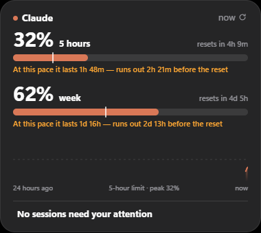

# Agent Monitor for Windows

A desktop widget and a tray icon for **Claude Code** and **Codex**: usage limits (5-hour and weekly) and which agents are **waiting on you**.

<p align="center">
  
</p>

A port of the macOS app in this repository. Windows has no desktop widgets like WidgetKit (the Windows 11 Widgets board needs an MSIX package and refreshes rarely), so this is a frameless window that sits on the desktop, plus a tray icon. Built with Tauri 2: the core is Rust, the widget is plain HTML/CSS/JS with no bundler. [Русская версия](README.ru.md).

## Features

- **Usage limits.** Rings for the 5-hour and weekly windows with a countdown to the reset. Amber at 75%, red at 90%.
- **Waiting on you.** Blockers first, in red: a tool call needs approval, the agent asked a question, or there is a plan to review. Finished turns below. Click a row to open that session.
- **Tray icon.** Shows the number of waiting sessions, red when something is blocked. Left click brings the widget above the windows, another click sends it back to the desktop. Right click opens the menu.
- **Zero config.** Reuses the logins you already have in Claude Code and Codex CLI.
- **English and Russian.** Follows the Windows display language; `AGENT_MONITOR_LANG=en|ru` overrides it.

## Settings (right click the tray icon)

- **Show.** Claude and Codex, Claude only or Codex only: applies to the limits, the session list and the tray counter. The limits block and the sessions block can each be hidden.
- **Appearance.** Limits as rings, as thin bars (the small widget), or large with a chart; *Auto* picks rings for two agents and the large view for one. Size: narrow (240), regular (380) or wide (560 px). Theme: match Windows, dark or light.
- **Session layout.** Two-line list, one-line compact list, or cards. Show 3, 6, 12 or all sessions.

The large view adds a pace mark on each bar (how much of the window has passed), a forecast ("at this pace it lasts 1h 48m") and a chart of the 5-hour limit over the last 24 hours. Samples for the chart are taken every 5 minutes and kept for 7 days.

## Build and run

Needs Node.js, Rust (MSVC toolchain) and WebView2 (already part of Windows 11).

```powershell
cd windows
npm install
npm run build
```

The result is `src-tauri\target\release\agent-monitor.exe`. `npm run installer` builds an NSIS installer.

Then:

1. Drag the widget where you want it, by any empty spot.
2. Click **Connect Claude Code** and/or **Connect Codex** in the widget (or *Integrations* in the tray menu). Restart sessions that are already open. Codex asks you to trust new hooks: `/hooks` in the CLI, or Settings → Hooks.
3. Turn on **Launch at Login** in the tray menu.

## How it works

| Agent  | Where the credentials come from   | Where the usage comes from |
|--------|-----------------------------------|----------------------------|
| Claude | `~/.claude/.credentials.json`     | `api.anthropic.com/api/oauth/usage` |
| Codex  | `~/.codex/auth.json`              | `chatgpt.com/backend-api/wham/usage`, falling back to the latest `rate_limits` event in `~/.codex/sessions` |

Hooks run the same binary: `agent-monitor.exe --hook claude|codex`. It reads the event from stdin, updates a per-session file in `%LOCALAPPDATA%\AgentMonitor\sessions\`, prints nothing and always exits 0, so it never changes the agent's behavior. It is a GUI-subsystem binary, so a hook never flashes a console window. Hooks point at a copy of the binary in `%LOCALAPPDATA%\AgentMonitor\bin\`, so the app can be moved or rebuilt.

The states are the same as on macOS:

| Event | State |
|---|---|
| `PermissionRequest`, Claude `Notification: permission_prompt` | **Needs approval** |
| Claude `AskUserQuestion`, `elicitation_dialog` | **Question for you** |
| Claude `ExitPlanMode` | **Plan to review** |
| `Stop` (nothing running in the background) | **Your turn** |
| `UserPromptSubmit`, `PostToolUse` | working (hidden) |
| `SessionEnd`, or the agent process exited | removed |

Jumping to a session: the Claude and Codex desktop apps open on the exact session through their deep links (`claude://`, `codex://`). For everything else (Windows Terminal, VS Code) the window that hosts the agent comes to the front; Windows Terminal offers no way to select a tab from outside.

## Differences from the macOS app

| | macOS | Windows |
|---|---|---|
| Widget | WidgetKit, in the widget gallery | a frameless window pinned to the desktop |
| Claude credentials | Keychain | `~/.claude/.credentials.json` |
| Claude desktop session records | `~/Library/Application Support/Claude` | `%APPDATA%\Claude`, or under `%LOCALAPPDATA%\Packages\Claude_*` for the Store build |
| Jump to a terminal tab | Terminal and iTerm2 | the window only |
| Session files | `~/Library/Application Support/AgentMonitor` | `%LOCALAPPDATA%\AgentMonitor` |

## Caveats

- **Both usage endpoints are undocumented** and can change without notice.
- **Claude tokens expire.** The CLI refreshes its token only while it runs. When it has expired, Agent Monitor refreshes it the same way the CLI does and writes it back to `.credentials.json` (atomically, checked after writing, restored if anything looks off).
- **The system route only.** Requests go through the proxy Windows is set to use (what a VPN client configures), or directly when there is none. There is no fallback: proxies named in the environment (`HTTPS_PROXY`) or in `~/.claude/settings.json` are ignored, so a request never goes around the system VPN. The route in use is written to `app.log`. PAC scripts aren't supported.
- **Editing configs.** *Connect* adds hooks to `~/.claude/settings.json` or `~/.codex/hooks.json`. Other hooks and the key order are kept, and a `*.agentmonitor-backup` copy is saved next to the file. A config that can't be parsed is never overwritten. *Disconnect* removes only Agent Monitor's hooks.
- **Win+D** minimizes the widget too. A left click on the tray icon brings it back.
- **Command line.** `agent-monitor.exe --connect claude|codex` and `--disconnect claude|codex` do the same as *Integrations*.
- Errors are logged to `%LOCALAPPDATA%\AgentMonitor\app.log`. `AGENT_MONITOR_DEBUG=1` traces hook calls to `hook.log`.

## Development

```
src-tauri/src/
  main.rs            entry point: --hook, --connect, or the tray app
  app.rs             polling, session watching, tray menu, window
  hook.rs            hook handler (port of App/Hook.swift)
  installer.rs       adds/removes hooks in the agents' configs
  sources.rs         usage endpoints, token refresh, system proxy
  jumper.rs          opens a session: deep links or the host window
  claude_desktop.rs  Claude desktop app's session records
  proc.rs            process tree and windows (Win32)
  model.rs, store.rs models and files in %LOCALAPPDATA%\AgentMonitor
  trayicon.rs        tray icon drawn at runtime
  i18n.rs            English / Russian
ui/                  the widget: index.html, style.css, app.js
```

Tests cover the hook installer (other hooks and settings survive connect and disconnect) and the event parsing:

```powershell
cargo test --manifest-path src-tauri/Cargo.toml
```
